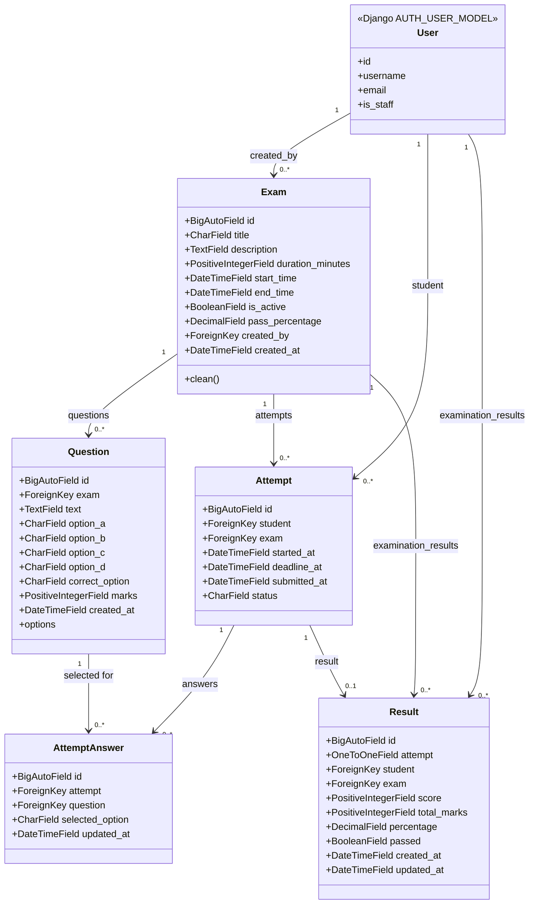

# Online Examination Portal — class diagram

This class diagram reflects the models currently present on the repository's main branch, including the persisted Result model and scoring fields integrated by PR #24. It is an implementation-aligned model view, not a proposed future schema.

## Relationships and constraints

- **User–Exam:** each Exam has one creator; a User may create many exams. Creator deletion is protected (PROTECT).
- **User–Attempt:** each Attempt belongs to one student; a User may have many attempts. Student deletion is protected.
- **Exam–Question:** each Question belongs to one Exam; deleting an Exam cascades to its questions.
- **Exam–Attempt:** each Attempt belongs to one Exam; Exam deletion is protected. A unique constraint permits one attempt per student/exam.
- **Attempt–AttemptAnswer:** an Attempt has zero or many saved answers; deleting an Attempt cascades to its answers. One answer per attempt/question is enforced by a unique constraint.
- **Question–AttemptAnswer:** each saved answer refers to one Question; deleting a referenced Question is protected. Selected option is A, B, C or D.
- **Attempt–Result:** each Result refers to exactly one Attempt through a OneToOneField; each Attempt has zero or one Result. Deletion of a referenced Attempt is protected.
- **User–Result and Exam–Result:** each Result records the student and exam for the evaluated attempt; both references use PROTECT.
- **Exam scoring configuration:** pass_percentage is a DecimalField (default 50.00) constrained by model validation to 0–100.
- **Question scoring configuration:** marks is a PositiveIntegerField (default 1).
- **Result values:** score and total_marks are positive integers; percentage is Decimal(6,2); passed is boolean; created_at and updated_at are timestamps.

## Status and evaluation behaviour

Attempt status is IN_PROGRESS, SUBMITTED or AUTO_SUBMITTED. The result evaluation service compares saved answers with each question's correct option, sums the marks assigned to correctly answered questions, calculates percentage against total marks, checks the exam pass threshold, and persists one Result per attempt. Evaluation is limited to submitted or auto-submitted attempts and uses a transaction/row lock plus update_or_create to make persistence idempotent.

The model and service details were checked against the merged implementation in results/models.py and results/services.py. The editable draw.io class diagram is committed separately; the PNG export remains a separate evidence deliverable.
