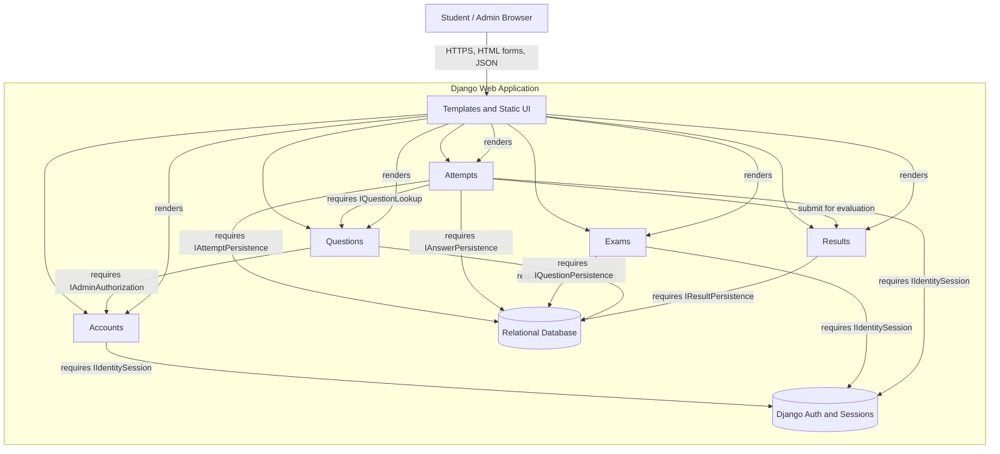

# Online Examination Portal — component diagram

Logical component view of the modular Django monolith. The boxes are Django apps, not separately deployed services. The UML component view uses provided interfaces (lollipop) and required interfaces (socket); the interface contracts below are logical boundaries between Django apps, not claims that Python ABC/interface classes exist.

## Provided and required interface catalogue

| Component | Provided interface (lollipop) | Required interface (socket) |
|---|---|---|
| Accounts | IIdentitySession — registration, login/logout, authenticated identity and role guards | Django authentication backend, session middleware |
| Exams | IExamAdministration — exam list, create/edit and student availability views | IIdentitySession, IExamPersistence |
| Questions | IQuestionManagement — question list, create, edit and delete workflows | IAdminAuthorization, IExamLookup, IQuestionPersistence |
| Attempts | IAttemptLifecycle — start, timed attempt, save/change answer and submit | IIdentitySession, IExamAvailability, IQuestionLookup, IAttemptPersistence, IAnswerPersistence, IResultEvaluation |
| Results | IResultPresentation — student result list/detail and administrator result list | IIdentitySession, IResultPersistence, persisted evaluation outcome and ownership data |
| Templates/static UI | IPortalPresentation — server-rendered screens and browser interactions | App view contexts, named URLs and static assets |
| Django auth/session | IIdentitySession — authenticated user and session state | User model and configured session store |
| Relational database | Persistence interfaces for Exam, Question, Attempt, AttemptAnswer and Result records | Database engine and Django ORM configuration |

## Interface connections

- Browser invokes IPortalPresentation over HTTPS. State-changing form submissions use POST with CSRF protection; answer changes use the JSON endpoint.
- IPortalPresentation routes requests to the relevant app views; it is not a separately deployed service.
- IAttemptLifecycle consumes IQuestionLookup and persistence interfaces, and hands a submitted attempt to the result-evaluation workflow.
- IResultPresentation exposes only the current student's own result and the administrator result register, subject to role and ownership checks.
- The persistence interfaces are logical contracts implemented through Django ORM models/querysets; they are not independent network APIs.

The deployment is a single Django application sharing one configured relational database. The editable UML draw.io component diagram is committed as `docs/diagrams/component_diagram.drawio`; its PNG export remains a separate visual evidence asset.
