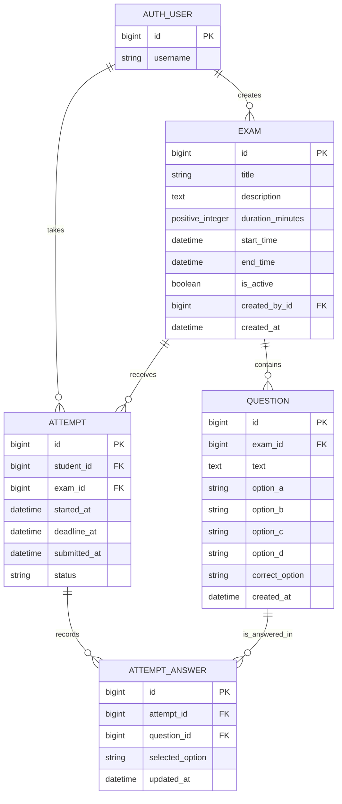

# Online Exam Portal — ER diagram

This diagram reflects the Django models currently implemented in the portal.
The user entity is Django's configured `AUTH_USER_MODEL` (the default project
configuration uses `auth.User`).

## Relationship and integrity notes

- A user may create many examinations; every examination has one creator.
- An examination may contain many questions and have many student attempts.
- A student may have at most one attempt per examination, enforced by the
  `unique_student_exam_attempt` constraint.
- An attempt may store one latest answer per question, enforced by the
  `unique_answer_per_attempt_question` constraint.
- Deleting an examination cascades to its questions. Attempts protect their
  examination and student rows; attempt answers cascade with their attempt and
  protect referenced questions.
- Correct answers are stored on questions; student selections are stored on
  attempt answers. Results are calculated from these records; there is no
  separate results table in the current schema.
