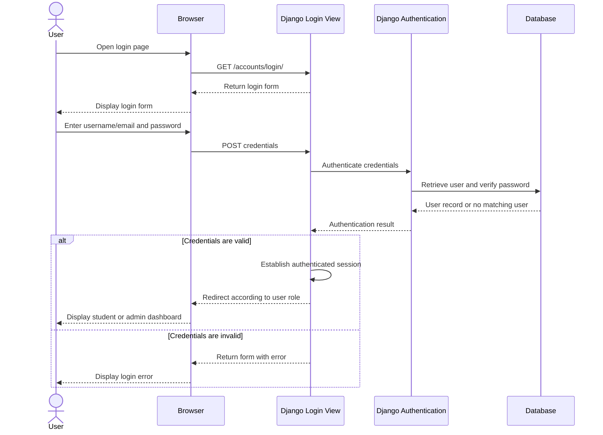

# OEP-66: Login Sequence Diagram

**Status:** Intended design based on the SRS and authentication-view contract. Confirm future authentication-flow changes against the implementation before updating this diagram.

